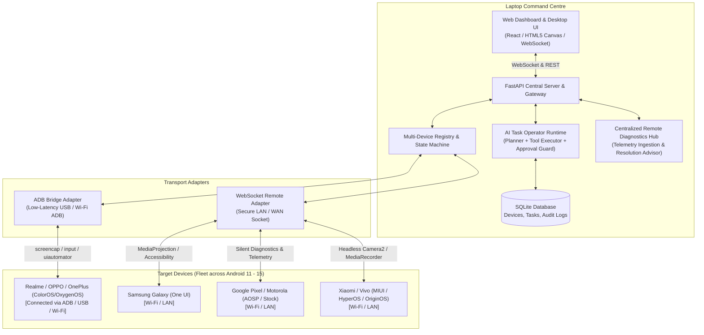
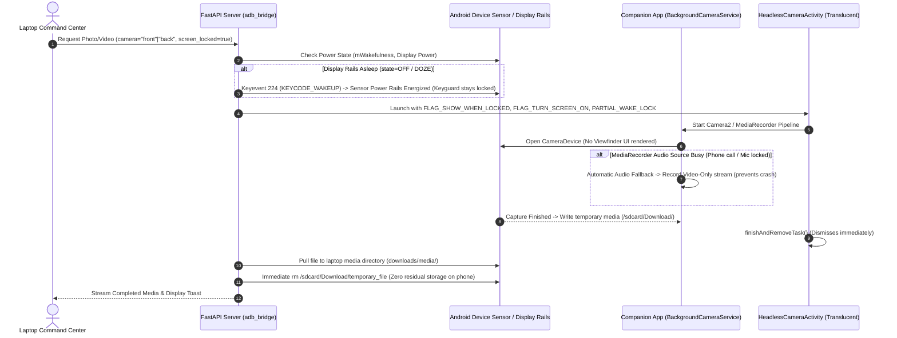
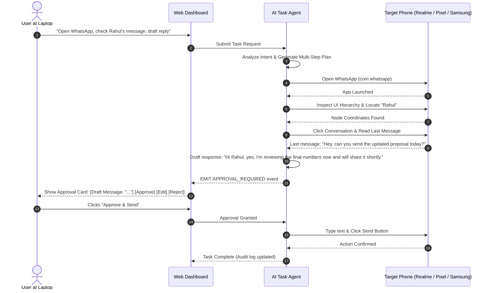

# Android Control Centre & Multi-Device AI Operator
## System Architecture & Technical Specification

The system operates as a hybrid command-and-control platform designed to turn one or more Android devices into remote-operable execution units commanded from a central laptop running Linux.



---

### 2. Dual-Transport Engine Architecture

To guarantee zero-friction immediate usage and wireless freedom, the system implements a **Dual-Transport Architecture**:

1. **ADB Bridge Transport (Zero-Install / USB / Wi-Fi ADB)**:
   - Utilizes Android Debug Bridge protocol directly.
   - Screen streaming via hardware framebuffer capture (`exec-out screencap` / high-speed frame pipeline).
   - Touch, gesture, and text injection via `/system/bin/input`.
   - UI tree inspection and accessibility bounding boxes via `uiautomator dump`.
   - File push/pull and APK management natively.
   - Display rail wakeup via Keyevent 224 (`KEYCODE_WAKEUP`) for locked/screen-off sensors.
   - **Advantage**: Requires zero setup on the phone beyond USB debugging. Works immediately.

2. **Native Android Companion Transport (Jetpack Compose APK)**:
   - Runs as a persistent Foreground Service on the smartphone with declared Android 14/15 FGS types:
     - `FOREGROUND_SERVICE_CAMERA`
     - `FOREGROUND_SERVICE_MICROPHONE`
     - `FOREGROUND_SERVICE_PHONE_CALL`
     - `FOREGROUND_SERVICE_CONNECTED_DEVICE`
   - Uses `AccessibilityService` for precise view hierarchy monitoring, instant node clicking, text entry, and notification intercept.
   - Uses `MediaProjection` API for hardware-accelerated 60 FPS H.264/WebRTC screen casting.
   - **Headless Camera Hardware Subsystem**: Direct `Camera2` API and translucent `HeadlessCameraActivity` with `showWhenLocked="true"` and `turnScreenOn="true"`. Captures silent photos and records MP4 videos while the device remains locked, without opening OEM stock camera apps or waking interactive keyguards.
   - **Silent Diagnostics Pipeline**: Traps all uncaught exceptions (`Thread.setDefaultUncaughtExceptionHandler`), prevents OS crash popups or toasts, and streams structured telemetry to the laptop dashboard.
   - Uses `AudioRecord` and `AudioTrack` for full-duplex telephony voice bridging with laptop speakers/microphone.
   - Communicates with Laptop Server over secure JSON WebSockets with instant ADB fallback.

---

### 3. Multi-Device Fleet Management

Each device registered in the system has a unified identity model:

```json
{
  "device_id": "realme_rmx3031_FMOVVW6HMRQ4C6RS",
  "name": "Realme X7 Max 5G",
  "model": "RMX3031",
  "brand": "realme",
  "android_version": "13",
  "sdk_int": 33,
  "display": {
    "width": 1080,
    "height": 2400,
    "density": 480
  },
  "battery": {
    "level": 51,
    "charging": true,
    "temperature": 31.8
  },
  "storage": {
    "total_gb": 108.0,
    "used_gb": 76.0,
    "free_gb": 32.0,
    "used_percent": 71
  },
  "transport": "adb",
  "status": "online",
  "active_package": "com.android.launcher",
  "capabilities": [
    "screen_mirror",
    "touch_injection",
    "keyboard_input",
    "app_management",
    "file_transfer",
    "ui_hierarchy_dump",
    "camera_capture",
    "audio_recording",
    "screen_off_capture",
    "remote_diagnostics"
  ],
  "hardware_capabilities": {
    "rear_hardware_level": "FULL (Level 1)",
    "front_hardware_level": "LIMITED (Level 0)",
    "max_photo_resolution": "1920x1080 (FHD)",
    "max_video_resolution": "1280x720 (HD H.264)",
    "has_flash": true
  },
  "permissions": {
    "camera": true,
    "microphone": true,
    "storage": true,
    "notifications": true,
    "accessibility": true,
    "ignore_battery_optimizations": true
  }
}
```

---

### 4. Headless Screen-Off & Locked Device Operations

Remote camera capture and video recording when the screen is turned off or locked operates under the following hardware and OS state machine:



---

### 5. Centralized Remote Diagnostics & Error Telemetry

To ensure the operator never needs to physically touch the phone when an error occurs, all errors are handled silently on the device and streamed to the laptop:

1. **Silent Exception Interception**:
   - `RemoteDiagnosticManager` registers a custom `Thread.UncaughtExceptionHandler`.
   - Prevents Android's default "App has stopped" dialog, OS crash popups, or jarring toasts.
   - Catches fatal exceptions, logs them structured, and triggers a clean process restart or background service recovery.

2. **Offline Diagnostic Buffer**:
   - Maintains a local in-memory FIFO queue (capacity 50) on the device.
   - If the WebSocket or network link is temporarily interrupted, diagnostic events are preserved and automatically flushed to the laptop upon reconnection.

3. **Structured Telemetry Format**:
   ```
   Device ID -> Module -> Operation -> Error Code -> Description -> Suggested Resolution -> Timestamp
   ```

4. **Actionable Resolution Advisor**:
   - Every telemetry report includes a field-tested `suggested_resolution`.
   - Examples:
     - `CAMERA_OPEN_FAILED` -> "Display rails asleep or camera held by another process. Trigger 'Wake Rails' or check foreground lock."
     - `AUDIO_RECORDER_BUSY` -> "Microphone occupied by cellular telephony or voice assistant. Fallback video-only recording active."
     - `PERMISSION_DENIED_MEDIA` -> "Android 13+ Scoped Storage requires READ_MEDIA_VIDEO/READ_MEDIA_IMAGES. Grant via adb pm grant."

---

### 6. Universal Multi-Device Compatibility Matrix (Android 11 – 15)

| Subsystem / Operation | Android 11 (API 30) | Android 12 (API 31–32) | Android 13 (API 33) | Android 14 (API 34) | Android 15 (API 35) | OEM Special Considerations |
|---|---|---|---|---|---|---|
| **Headless Photo Capture** | `Camera2` Direct | `Camera2` Direct | `Camera2` Direct | Requires `camera` FGS Type | Requires `camera` FGS Type | Xiaomi/MIUI requires "Display pop-up windows while running in the background" permission. |
| **Silent Video Recording** | `MediaRecorder` | `MediaRecorder` | `MediaRecorder` | Requires `camera` + `microphone` FGS | Requires `camera` + `microphone` FGS | Auto audio-busy fallback prevents crash when mic is shared. |
| **Lockscreen Capture** | `FLAG_SHOW_WHEN_LOCKED` | `setShowWhenLocked(true)` | `setShowWhenLocked(true)` | `USE_FULL_SCREEN_INTENT` declared | `USE_FULL_SCREEN_INTENT` declared | Samsung One UI requires partial wake lock to prevent immediate keyguard re-sleep. |
| **Screen-Off Rail Wakeup** | Keyevent 224 | Keyevent 224 | Keyevent 224 | Keyevent 224 | Keyevent 224 | Works uniformly across AOSP, ColorOS, One UI, HyperOS. |
| **Storage & File Transfer** | Legacy / Scoped Storage | Scoped Storage | `READ_MEDIA_IMAGES` / `READ_MEDIA_VIDEO` | Scoped Storage + User Selected Photos | Scoped Storage + User Selected Photos | Handled dynamically via `Build.VERSION.SDK_INT` detection. |
| **Background Execution** | Standby Buckets | Foreground Service Start Restrictions | Notification Runtime Permission | Foreground Service Type Enforcement | Stricter FGS Launch Rules (Context-based) | Foreground services declare explicit operational types in Manifest. |
| **Silent Diagnostics** | UncaughtExceptionHandler | UncaughtExceptionHandler | UncaughtExceptionHandler | UncaughtExceptionHandler | UncaughtExceptionHandler | 100% uniform across all versions and manufacturers. |

---

### 7. AI Operator & Human-in-the-Loop Safety Loop

The AI operator follows a strict **Plan -> Propose -> Approve -> Execute -> Verify** loop:


